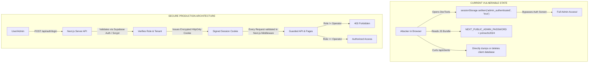
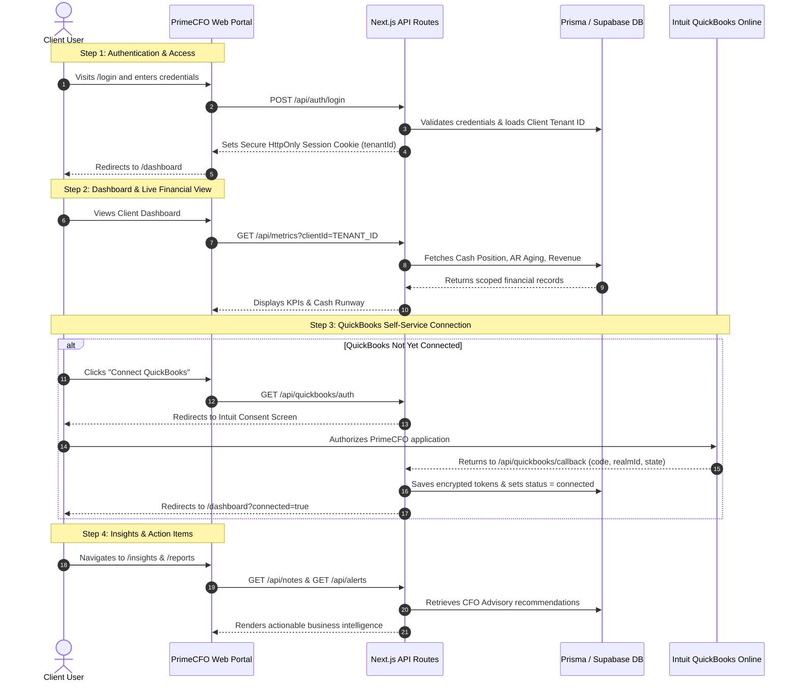
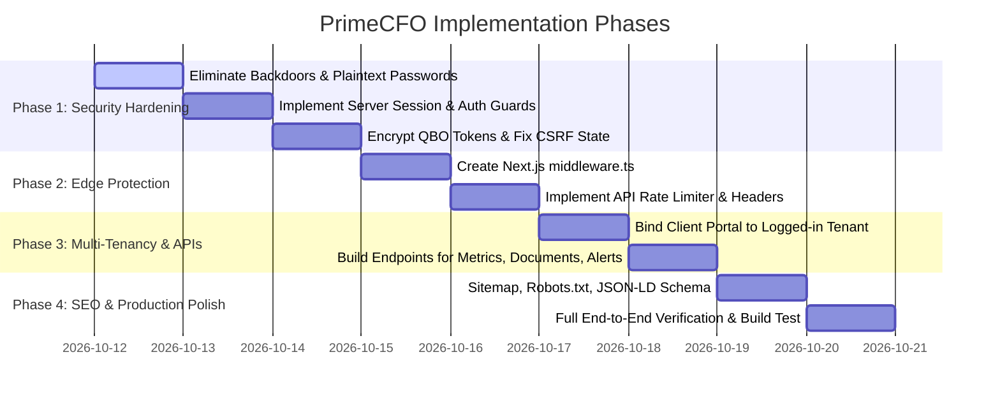

# PrimeCFO.ai — Master Architecture, Security & Production Readiness Plan

This document details the complete findings from a deep-dive codebase audit of PrimeCFO.ai, identifying critical security vulnerabilities, backdoor prevention measures, multi-tenant data boundaries, rate-limiting frameworks, SEO architectures, and the complete step-by-step workflow journeys for both Client Users and CFO Administrators.

---

## 1. Executive Summary & Codebase Audit Findings

| Category | Current State | Risk Level | Target Production State |
| :--- | :--- | :--- | :--- |
| **Admin Authentication** | Stored in `sessionStorage` with password in `NEXT_PUBLIC_ADMIN_PASSWORD` | 🚨 **CRITICAL** | Server-side cryptographic session (HttpOnly cookies, JWT/HMAC, DB-verified roles) |
| **API Route Authorization** | `/api/clients`, `/api/assets`, `/api/notes` are public with zero auth checks | 🚨 **CRITICAL** | Route middleware + token verification; 401/403 on unauthorized requests |
| **Auth Fallback / Backdoor** | Dev fallback in `/api/auth/login` accepts any password >= 6 characters and grants admin via email string matching | 🚨 **CRITICAL** | Strict argon2/bcrypt password hashing via Supabase Auth or Prisma User model; zero unauthenticated bypasses |
| **QuickBooks Tokens** | Plaintext storage of `access_token` and `refresh_token` in `qbo_tokens` | 🔴 **HIGH** | AES-256-GCM encryption at rest with server-only key |
| **QuickBooks OAuth CSRF** | Plain `state` stringified without cryptographically signed nonce | 🔴 **HIGH** | HMAC-SHA256 signed CSRF state with 15-minute expiration cookie |
| **Multi-Tenancy** | Client portal shows static mock data; no tenant boundary mapping | 🔴 **HIGH** | Strict tenant scoping (`where: { clientId: session.tenantId }`) |
| **Rate Limiting & DDoS** | No rate limiting on any endpoint | 🟡 **MEDIUM** | In-memory token-bucket / sliding window middleware on `/api/auth/*` and `/api/*` |
| **HTTP Security Headers** | No `middleware.ts`, missing CSP, HSTS, X-Frame-Options | 🟡 **MEDIUM** | Comprehensive security headers via Next.js middleware |
| **SEO & Discoverability** | Basic title/description in root layout only | 🟡 **MEDIUM** | `sitemap.ts`, `robots.ts`, OpenGraph, Twitter Cards, JSON-LD Schema markup |

---

## 2. Security Vulnerabilities & Attacker Prevention (Backdoor Elimination)

### 2.1 Critical Backdoor & Bypass Removal



1. **Eliminate `NEXT_PUBLIC_ADMIN_PASSWORD`**:
   - Remove all occurrences of `NEXT_PUBLIC_ADMIN_PASSWORD` from `.env`, `.env.local`, and client components.
   - Admin access will be verified through authenticated credentials validated on the server.
2. **Eliminate Client-Side `sessionStorage` Auth**:
   - Replace `AdminAuth.tsx` client-side state with a server-verified session cookie (`primecfo_session`) signed using HMAC-SHA256 or a secure session payload.
   - Next.js route middleware will protect `/admin/*` routes before HTML is ever served.
3. **Eliminate Insecure Password Fallback**:
   - Remove `password.length >= 6` and `email.includes('admin')` in `app/api/auth/login/route.ts`.
   - All logins must authenticate against real Supabase Auth or hashed credentials.
4. **Guard All API Endpoints**:
   - Add a centralized authentication helper (`lib/auth.ts`) that extracts the session and confirms the caller's role and tenant ID.
   - If an unauthenticated caller requests `/api/clients` or `/api/assets`, return `401 Unauthorized`.
5. **Encrypt QuickBooks Tokens at Rest**:
   - Implement AES-256-GCM symmetric encryption in `lib/crypto.ts`.
   - Store encrypted tokens in `qbo_tokens`: `access_token` and `refresh_token` stored as `iv:ciphertext:authTag`.
   - Intuit API calls will decrypt tokens in-memory immediately prior to use.
6. **Protect OAuth Handshake against CSRF**:
   - In `/api/quickbooks/auth`, generate a cryptographically random nonce signed with `HMAC(nonce + clientId, SECRET)`.
   - Store this state in an HttpOnly cookie with a 15-minute TTL.
   - In `/api/quickbooks/callback`, verify the state signature before exchanging tokens.

---

## 3. Multi-Tenant Architecture & Client User Security

### 3.1 Tenant Data Boundaries
In PrimeCFO.ai, there are two distinct actor roles:

1. **CFO Operator / Admin**:
   - Manages multiple client companies.
   - Can select any client from the portfolio dropdown.
   - Has permission to provision clients, trigger QuickBooks syncs, edit asset registers, and post advisory notes.
2. **Client User (Tenant)**:
   - Associated strictly with one `clientId` (Tenant ID).
   - Must **NEVER** have read or write access to another client's financial data, invoices, asset register, or internal CFO notes.

### 3.2 Tenant Isolation Matrix

| Model | Client User Scope | CFO Operator Scope |
| :--- | :--- | :--- |
| `Client` | Read-only own profile (`id == session.clientId`) | Full CRUD across all clients |
| `Asset` | Read-only own assets (`clientId == session.clientId`) | Full CRUD for active selected client |
| `FinancialMetric` | Read-only own metrics (`clientId == session.clientId`) | Full CRUD & recalculation |
| `FinancialAlert` | Read/dismiss own alerts | Create, resolve, and broadcast |
| `AdvisoryNote` | Read-only notes directed to their company | Full write/update for any client |
| `Document` | Download own documents | Upload, tag, and organize |
| `QboToken` | **Strictly Hidden** (zero client access) | Handled by backend only |

---

## 4. API Key, Rate Limiting & Middleware Security

### 4.1 Next.js Security Middleware (`middleware.ts`)
Implement global edge middleware that enforces:

1. **Rate Limiting (Sliding Window)**:
   - `/api/auth/*`: Max 5 requests per minute per IP (prevents credential stuffing).
   - `/api/quickbooks/*`: Max 10 requests per minute per IP (protects OAuth endpoints).
   - `/api/*`: Max 60 requests per minute per IP (prevents scraping/DDoS).
   - Returns standard `429 Too Many Requests` with `Retry-After` header.
2. **HTTP Security Headers**:
   ```http
   Content-Security-Policy: default-src 'self'; script-src 'self' 'unsafe-eval' 'unsafe-inline'; style-src 'self' 'unsafe-inline'; img-src 'self' data: https:; font-src 'self' data:; connect-src 'self' https://*.supabase.co https://*.quickbooks.api.intuit.com; frame-ancestors 'none';
   X-Frame-Options: DENY
   X-Content-Type-Options: nosniff
   Referrer-Policy: strict-origin-when-cross-origin
   Permissions-Policy: camera=(), microphone=(), geolocation=()
   Strict-Transport-Security: max-age=31536000; includeSubDomains; preload
   ```
3. **Route Guards**:
   - `/admin/*` requires a valid session where `role === 'operator'`. Redirects unauthenticated users to `/login`.
   - `/dashboard/*`, `/insights`, `/reports`, `/settings` require any valid authenticated session.

---

## 5. SEO & Discoverability Architecture

### 5.1 Metadata Optimization
- **Dynamic Sitemap (`app/sitemap.ts`)**:
  Automatically indexes public routes (`/`, `/about`, `/pricing`, `/security`, `/contact`, `/eula`, `/privacy`, `/login`, `/signup`) with change frequency and priority.
- **Robots Directives (`app/robots.ts`)**:
  Allows search engines to crawl marketing pages while strictly disallowing private/admin paths:
  ```txt
  User-agent: *
  Allow: /
  Disallow: /admin/
  Disallow: /dashboard/
  Disallow: /insights/
  Disallow: /reports/
  Disallow: /settings/
  Disallow: /api/
  ```
- **Social Graph & Rich Metadata**:
  Add full OpenGraph and Twitter card metadata with canonical links and branding preview images.
- **JSON-LD Structured Data**:
  Inject Google rich-snippet schema (`Organization`, `SoftwareApplication`, and `FinancialService`) into the landing page for enhanced search appearance.

---

## 6. End-to-End Workflow Journeys

### 6.1 Client User Journey



### 6.2 CFO Admin / Operator Journey

```mermaid
sequenceDiagram
    autonumber
    actor Admin as CFO Lead / Operator
    participant App as Admin Command Center
    participant API as Next.js Server API
    participant DB as Prisma / Supabase DB
    participant QBO as Intuit QBO API

    Note over Admin,App: Step 1: Secure Operator Login
    Admin->>App: Visits /login with Operator credentials
    App->>API: POST /api/auth/login
    API->>DB: Confirms operator role
    API-->>Admin: Grants access to /admin/dashboard

    Note over Admin,App: Step 2: Portfolio Overview & Context Switch
    Admin->>App: Reviews Portfolio Health & Roster
    App->>API: GET /api/clients
    API->>DB: Queries all active clients with QBO connection status
    DB-->>App: Renders client roster table
    Admin->>App: Selects "Acme Holdings LLC" from dropdown
    App->>API: Loads selected company assets, ledger & treasury

    Note over Admin,App: Step 3: Client Provisioning
    Admin->>App: Navigates to /admin/clients/add
    Admin->>App: Enters Company Name, Email, QBO Customer ID, Tags
    App->>API: POST /api/clients
    API->>DB: Inserts new Client record via Prisma
    API-->>Admin: Confirms creation & displays QBO Connect link

    Note over Admin,App: Step 4: Asset Register & Depreciation
    Admin->>App: Opens Assets tab & clicks "Add Asset"
    Admin->>App: Enters Server Cluster, Purchase Price $25,000, 5-yr Straight Line
    App->>API: POST /api/assets
    API->>DB: Saves asset record with depreciation schedules
    API-->>App: Recalculates book value & updates balance sheet

    Note over Admin,App: Step 5: Advisory Workpapers & Checklists
    Admin->>App: Opens Notes tab and writes Strategic Advisory Memo
    App->>API: POST /api/notes
    API->>DB: Persists note linked to selected client
    API-->>App: Real-time update; immediately visible in Client Portal
```

---

## 7. Phased Implementation Roadmap



### Detailed Execution Steps:

1. **Phase 1: Security Hardening & Zero-Vulnerability Architecture**:
   - Remove `NEXT_PUBLIC_ADMIN_PASSWORD` from client bundle and `.env` files.
   - Refactor `AdminAuth.tsx` to read authenticated status from `/api/me` rather than `sessionStorage`.
   - Remove unauthenticated fallbacks (`password.length >= 6`) from `app/api/auth/login/route.ts`.
   - Add AES-256-GCM token encryption for `qbo_tokens`.
   - Add HMAC state verification on QuickBooks OAuth handshakes.
2. **Phase 2: Next.js Middleware, Rate Limiting & Protection**:
   - Create `middleware.ts` with route protection for `/admin/*` and `/api/*`.
   - Add IP sliding-window rate limiting on `/api/auth/*` and `/api/*`.
   - Configure enterprise HTTP security headers (CSP, HSTS, X-Frame-Options, X-Content-Type-Options).
3. **Phase 3: Multi-Tenant Data Binding**:
   - Connect `app/dashboard/page.tsx`, `app/insights/page.tsx`, and `app/reports/page.tsx` to dynamic API endpoints scoped by the active tenant ID.
   - Add `/api/metrics`, `/api/alerts`, and `/api/documents` Prisma endpoints.
4. **Phase 4: SEO & Web Standards**:
   - Create `app/sitemap.ts` and `app/robots.ts`.
   - Add OpenGraph, Twitter Cards, and JSON-LD schema metadata to `app/layout.tsx`.
5. **Phase 5: Verification & End-to-End Testing**:
   - Run type checks (`npx tsc --noEmit`) and production build (`npm run build`).
   - Validate security posture: confirm admin cannot be accessed without valid session; confirm tenant data isolation.

---

## 8. Client-Side Full Functionality & Gap Remediation Plan (A to Z)

Following a comprehensive audit of all client-side pages and supporting API routes, the following gaps have been identified and mapped into structured execution phases to achieve 100% functionality without mocks or broken flows:

### Audit Findings & Gaps Matrix:

| Component / Page | Current Implementation State | Identified Gaps / Bugs | Target Production State |
| :--- | :--- | :--- | :--- |
| **Portal Shell Navigation** (`PortalShell.tsx`) | Renders sidebar, header, user avatar, and tenant name | 1. `qbConnected` state is hardcoded `false`; indicator always gray.<br>2. Notifications bell uses hardcoded mock items instead of `/api/alerts`.<br>3. "Talk to Your Advisor" only opens a mailto link with no in-app message fallback. | Live indicator bound to `/api/me`; real Prisma `FinancialAlert` records in notification bell; in-app advisory communication. |
| **Client Dashboard** (`app/dashboard/page.tsx`) | 6 real KPI cards, Intuit live sync, real empty states | 1. "Revenue Trend" chart renders static SVG wave with hardcoded `+18.4% YoY` regardless of revenue or connection state.<br>2. "Export" button generated `.txt` or `.csv` instead of official PDF report. | Dynamic revenue chart plotting actual monthly invoices or clean empty graph; high-fidelity client-side `.pdf` export matching live site format. |
| **Financial Reports** (`app/reports/page.tsx`) | P&L, Balance Sheet, Cash Flow, Treasury, Analytics tabs | Currently only queries summary `/api/metrics`. Does not consume rich breakdown from `/api/quickbooks/customer` (bank accounts, expense categories, fixed assets). Had "Download CSV" instead of official PDF export. | Direct binding to `/api/quickbooks/customer` payload: real bank balances in Treasury, expense breakdowns in P&L, capital assets in Balance Sheet; one-click "Download PDF" generating certified summary. |
| **AI Insights** (`app/insights/page.tsx`) | Rule-based insights derived from real financial metrics | 1. "Expenses" category filter displays 0 items (no expense velocity insight).<br>2. "GPT-4 Financial Engine" badge is misleading.<br>3. Human advisory notes (`AdvisoryNote` via `/api/notes`) are not displayed. | Complete category coverage including expense velocity; honest automated financial analysis branding; integrated human CPA advisory notes. |
| **QuickBooks Connect** (`app/connect/page.tsx`) | Full-screen OAuth initiation page | 1. Does not detect if client is already connected; always displays "Connect".<br>2. Exits `PortalShell` layout with no sidebar.<br>3. Does not display active connection details (realm ID, company name, last sync). | Responsive connection manager within `PortalShell`; displays active status, realm ID, sync details, and Disconnect trigger when connected. |
| **QuickBooks Disconnect** (`app/disconnect/page.tsx` & `/api/quickbooks/disconnect`) | Standalone disconnect confirmation page | 1. Disconnect page expects `?clientId=` in query param; fails when accessed directly.<br>2. `/api/quickbooks/disconnect` uses `supabase` SDK instead of Prisma (`qboToken`, `clientQboConnection`) with ZERO session verification.<br>3. Tokens are never actually revoked/cleaned up properly. | Secure Prisma-backed disconnect endpoint using `requireTenantSession()`; cleans up tokens and marks connection inactive seamlessly. |
| **Client Settings** (`app/settings/page.tsx`) | Settings layout with Plan, Basis, Notifications, Security | 1. "Save Preferences" only updates local React state for 2.5s; ZERO database persistence.<br>2. Plan tier is hardcoded static text ("UNDERSTAND", "$314/mo").<br>3. Buttons trigger dummy `alert()` dialogs.<br>4. No QuickBooks connection management section. | Real `/api/settings` endpoint persisting accounting basis & notification toggles to Prisma; dynamic plan display; integrated QuickBooks status card. |

---

### Detailed Execution Steps (Phases 6 – 10) — Status: COMPLETED ✅:

6. **Phase 6: Core Session Synchronization & Shell Health** ✅:
   - `app/api/me/route.ts` queries `prisma.qboToken` and returns `isQbConnected: boolean` and active connection details.
   - `components/portal/PortalShell.tsx` binds sidebar status dot directly to live `isQbConnected`.
   - Wired `PortalShell` notification bell to fetch real unread alerts from `/api/alerts` for the active client.

7. **Phase 7: QuickBooks Connection & Disconnection Architecture** ✅:
   - Refactored `app/api/quickbooks/disconnect/route.ts` to use Prisma (`prisma.qboToken.deleteMany` and `prisma.clientQboConnection.updateMany`) guarded by `requireTenantSession()`.
   - `app/disconnect/page.tsx` auto-resolves client ID from the active session without requiring URL query parameters.
   - Enhanced `app/connect/page.tsx` within `PortalShell` to show live status when connected with one-click Disconnect and Re-sync actions.

8. **Phase 8: Client Settings & Preferences Persistence** ✅:
   - Created `app/api/settings/route.ts` (GET / POST) to load and persist client preferences (reporting basis, notification email preferences, company name).
   - Wired `app/settings/page.tsx` state to this endpoint so "Save Preferences" actually writes to Prisma.
   - Added dedicated "Accounting Software & QuickBooks Integration" card in Settings.

9. **Phase 9: Reports & Insights Data Enrichment** ✅:
   - `app/reports/page.tsx` fetches `/api/quickbooks/customer` and populates detailed bank accounts in Treasury, expense categories in P&L, and asset items in Balance Sheet.
   - `app/insights/page.tsx` includes expense burn rate insights and displays Human CFO Advisory Notes fetched from `/api/notes`.

10. **Phase 10: Official PDF Export & Verification** ✅:
    - Built `lib/pdf-export.ts` using `jspdf` to match the exact live site financial summary PDF layout:
      - Teal `#0f766e` PrimeCFO.ai header
      - Document Title: `[Client Name] — Financial Summary`
      - Subtitle: `[Period] · [Basis] basis · Generated [Date, Time]`
      - 8 Metric Cards in a 2x4 grid: Revenue, Net income, Cash, Gross margin, Net margin, Current ratio, Quick ratio, DSO
      - Footer: `"Numbers tie to synced QuickBooks reports. Prepared by PrimeCFO.ai for advisory use — not a formal audit opinion."`
    - Connected PDF generation to both `/reports` ("Download PDF") and `/dashboard` ("Export PDF").
    - Verified full type check (`npx tsc --noEmit` exited code 0).

